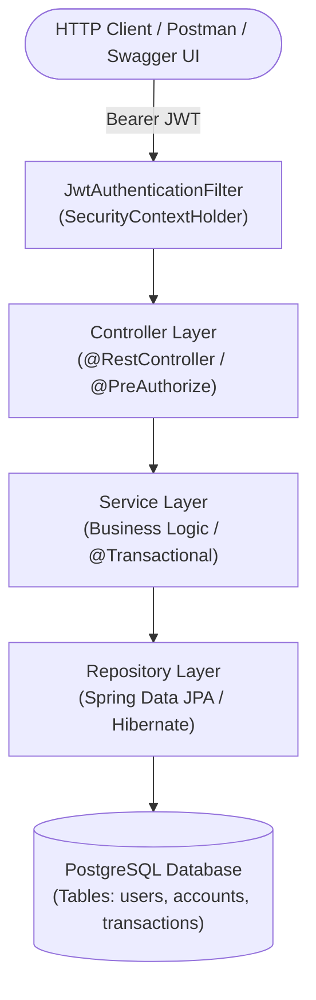
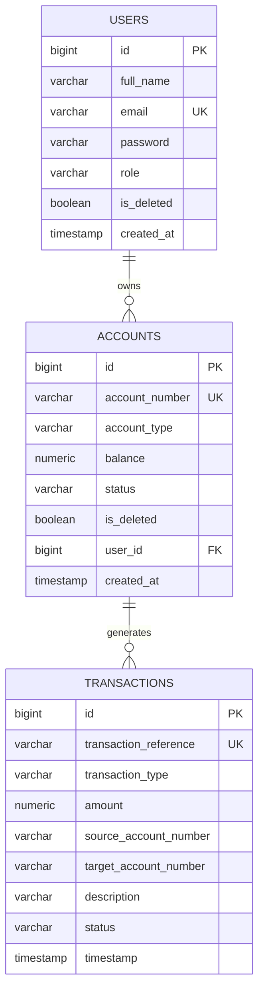

# 🏦 Mini Banking RESTful API

[](https://www.oracle.com/java/)
[](https://spring.io/projects/spring-boot)
[](https://www.postgresql.org/)
[](https://www.docker.com/)
[](LICENSE)

A production-ready **Mini Banking Backend REST API** built with **Java 21**, **Spring Boot 3**, **Spring Security 6**, **JWT Authentication**, and **PostgreSQL**. Designed adhering to enterprise banking standards: ACID transactional guarantees, atomic fund transfers, immutable financial ledgers, audit compliance via soft-deletes, and containerized deployment with Docker.

---

## 🏛️ System Architecture



---

## ✨ Core Banking Features

1. **Authentication & Authorization:**
   - Stateless **JWT (JSON Web Token)** authentication with HMAC-SHA256.
   - Passwords hashed using **BCrypt** with automatic salting.
   - Role-Based Access Control (**RBAC**): `ROLE_USER` and `ROLE_ADMIN` (`@PreAuthorize`).
2. **Account Management:**
   - Open bank accounts (`SAVINGS`, `CHECKING`) with auto-generated 10-digit account numbers.
   - High-precision monetary balances managed strictly with **`BigDecimal`** (preventing floating-point arithmetic errors).
   - **Ownership Guard**: Customers can only inspect or modify their own accounts.
3. **Core Financial Operations:**
   - **Cash Deposit:** Add funds to active accounts with transaction logging.
   - **Cash Withdrawal:** Balance validation and ownership verification.
   - **Atomic Fund Transfer (`@Transactional`):** Debits the sender and credits the receiver in a single atomic database transaction. If an error occurs midway, changes automatically **rollback** to prevent money creation or loss.
4. **Audit & Compliance:**
   - **Soft Delete Pattern:** Uses `@SQLDelete` and `@SQLRestriction` to retain user data for regulatory compliance.
   - **Immutable Transaction Ledger:** Every financial movement is permanently audited in the `transactions` table.
   - **Paginated Account Statements:** Sliced transaction queries via `Pageable` preventing memory bloat.
5. **API Quality & DevOps:**
   - Interactive **Swagger UI / OpenAPI 3** documentation with JWT Bearer support.
   - Uniform JSON error responses via `@RestControllerAdvice`.
   - Automated test suite (Unit & Integration tests with JUnit 5 & Mockito).
   - Containerized with multi-stage **Dockerfile** and **Docker Compose**.

---

## 🗄️ Database Schema (Entity-Relationship)



---

## 🚀 Quick Start

### Option 1: Run with Docker Compose (Recommended)
You can spin up the entire backend and PostgreSQL database with a single command:

```bash
docker-compose up --build -d
```
* **API Server:** `http://localhost:8080`
* **Swagger UI:** `http://localhost:8080/swagger-ui.html`
* **PostgreSQL:** `localhost:5432` (Database: `minibanking`, User: `postgres`)

To stop:
```bash
docker-compose down
```

---

### Option 2: Run Locally with Maven
Ensure you have **Java 21** and a local **PostgreSQL** instance running:

```bash
# Clone the repository
git clone https://github.com/mengtheth53-code/mini-banking-api.git
cd mini-banking-api

# Run the application
mvn spring-boot:run
```

---

## 📖 API Documentation & Swagger UI

Once running, explore and test the interactive API documentation at:  
👉 **`http://localhost:8080/swagger-ui.html`**

### Authenticating in Swagger UI:
1. Register via `POST /api/v1/auth/register` or login via `POST /api/v1/auth/login`.
2. Copy the `token` string from the JSON response.
3. Click the green **Authorize 🔓** button in Swagger UI.
4. Enter: `Bearer <your_token>` and click **Authorize**.

---

## 📬 Postman Collection

A complete Postman collection is included in the repository at:  
📁 `postman/mini-banking-api.postman_collection.json`

**Included Request Workflows:**
- Health Check (`GET /api/v1/health`)
- Register & Login (Automatically saves JWT to Postman variable)
- Open Account & Check Balance
- Deposit & Withdraw
- Atomic Transfer & Rollback Simulation Test (`simulateFailure: true`)
- Paginated Account Statement

---

## 🧪 Testing & Verification

Run the automated test suite with Maven:
```bash
mvn clean test
```

**Test Coverage Highlights:**
- **`TransferServiceTest`**: Verifies atomic balance deduction, credit, and mid-transfer `@Transactional` rollback.
- **`AuthServiceTest`**: Verifies password hashing with BCrypt and JWT generation.
- **`SoftDeleteTest`**: Proves `@SQLDelete` marks rows inactive without physical deletion.
- **`AccountRepositoryTest`**: Verifies `@ManyToOne` cascade persistence and `Pageable` slicing.

---

## 👨‍💻 Author

**Theth Meng**  
* GitHub: [@mengtheth53-code](https://github.com/mengtheth53-code)  
* Email: mengtheth53@gmail.com
